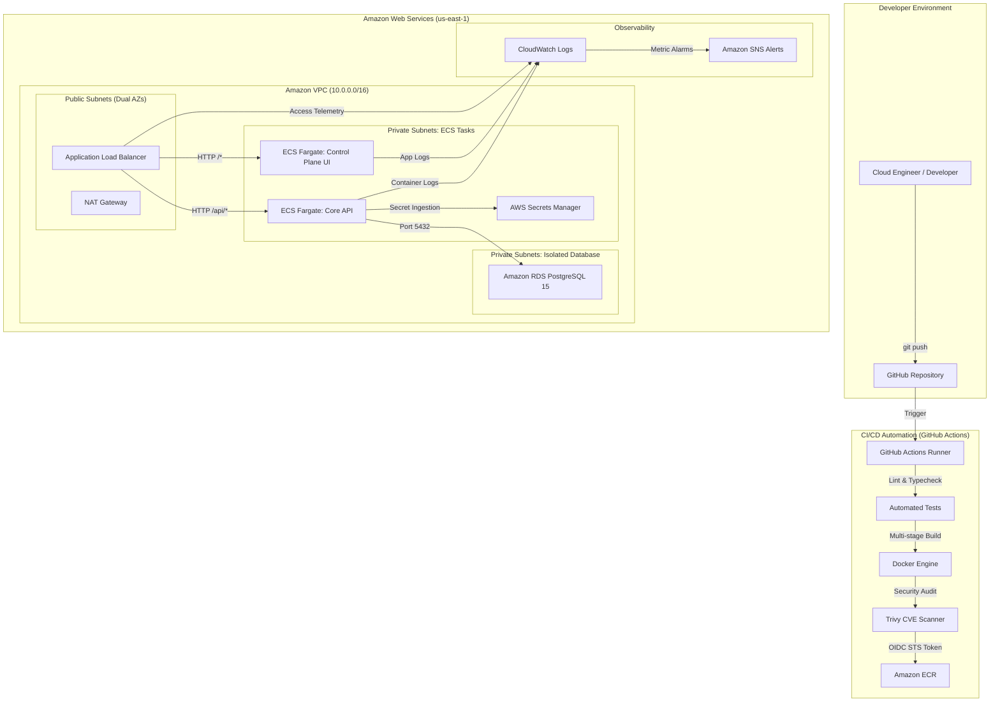

# AetherGrid

> **Engineering the Invisible.**

[](https://github.com/aethergrid/aethergrid/actions/workflows/ci.yml)
[](https://github.com/aethergrid/aethergrid/actions/workflows/docker.yml)
[](infrastructure/terraform)
[](docs/architecture.md)
[](LICENSE)

AetherGrid is a containerized cloud platform demonstrating modern Cloud Engineering and DevOps practices: how a software application transitions from source code through automated CI/CD into a secure, scalable, and observable AWS infrastructure.

Rather than an arbitrary CRUD application, AetherGrid features an **internal Cloud Infrastructure Control Plane** providing real-time visibility into microservices topology, deployment audit logs, runtime telemetry, and health probes.

---

## 1. System Architecture



---

## 2. Key Highlights & Architectural Features

- **Infrastructure as Code (Terraform):** 100% modular infrastructure provisioning VPC, tiered subnets, security groups, ALB, ECR, ECS Fargate, RDS PostgreSQL, IAM roles, and CloudWatch alarms.
- **Zero-Trust Network Segmentation:** Strict 3-tier topology. The database is in an isolated subnet with zero internet access, reachable only from the application security group on port 5432.
- **Serverless Compute (AWS ECS Fargate):** Fully managed, auto-recovering container orchestration running unprivileged, non-root Alpine containers.
- **Passwordless CI/CD Security:** GitHub Actions authenticates to AWS via OpenID Connect (OIDC) federation, eliminating static IAM keys.
- **Comprehensive Observability:** Real-time metrics, ring-buffered application logs, CloudWatch metric alarms for CPU, memory, 5XX errors, and unhealthy targets.
- **Multi-Level Health Checks:** Active cascading health check chain: `ALB -> ECS -> Container -> Application -> PostgreSQL`.
- **Cost Consciousness:** Defaults to low-cost configurations (`db.t4g.micro`, single NAT Gateway option in dev, ECR lifecycle cleanup) and clean `terraform destroy` workflows.

---

## 3. Technology Stack

| Layer | Technologies |
|---|---|
| **Control Plane UI** | Next.js (App Router, Standalone build), React, TypeScript, Vanilla CSS |
| **Core API Service** | Node.js, Express, TypeScript, pg (PostgreSQL driver), dumb-init |
| **Database** | Amazon RDS PostgreSQL 15 (Local: Docker PostgreSQL 15 Alpine) |
| **Packaging & Local Dev** | Docker, Multi-Stage Dockerfiles, Docker Compose |
| **Infrastructure as Code** | Terraform (Modular: networking, security, ecr, alb, rds, ecs, monitoring) |
| **Cloud Provider** | Amazon Web Services (VPC, Fargate, ALB, RDS, Secrets Manager, CloudWatch, ECR) |
| **CI/CD & Security** | GitHub Actions, AWS OIDC, Aquasecurity Trivy, ESLint, TypeScript Strict |

---

## 4. Quickstart: Local Development

The entire architecture can be run locally via Docker Compose with full environment parity:

### Prerequisites
- [Docker](https://docs.docker.com/get-docker/) & Docker Compose
- [Node.js](https://nodejs.org/) v20+ (for local scripts/tests)

### Running Locally
```bash
# Clone the repository
git clone https://github.com/your-username/aethergrid.git
cd aethergrid

# Spin up all services (PostgreSQL, Backend API, Frontend UI)
docker compose up --build
```

Access the services:
- **Control Plane UI:** [http://localhost:3000](http://localhost:3000)
- **Core API Health Check:** [http://localhost:4000/api/health](http://localhost:4000/api/health)
- **API Documentation & System Info:** [http://localhost:4000/api/system](http://localhost:4000/api/system)
- **Local PostgreSQL:** `localhost:5432` (`user: aethergrid_user`, `db: aethergrid_db`)

---

## 5. Provisioning AWS Infrastructure with Terraform

All AWS resources are defined in `infrastructure/terraform/`.

```bash
# 1. Navigate to the development environment
cd infrastructure/terraform/environments/dev

# 2. Initialize provider plugins and modules
terraform init

# 3. Create a parameter configuration
cp terraform.tfvars.example terraform.tfvars

# 4. Review and validate execution plan
terraform plan

# 5. Provision infrastructure
terraform apply
```

Outputs returned:
- `alb_dns_name`: Public DNS endpoint for the Application Load Balancer
- `backend_ecr_url`: Amazon ECR endpoint for backend image
- `frontend_ecr_url`: Amazon ECR endpoint for frontend image
- `rds_endpoint`: Private database endpoint

---

## 6. Continuous Integration & Deployment (CI/CD)

The `.github/workflows/` directory contains automated pipelines:

1. **`ci.yml`:** Executes on every Pull Request:
   - TypeScript strict typechecking
   - Backend unit tests (`tests/health.test.ts`)
   - Next.js production build verification
2. **`docker.yml`:** Executes on push to `main`:
   - Builds backend and frontend multi-stage Docker images
   - Runs Trivy vulnerability security scanner
3. **`deploy.yml`:** Automated release rollout:
   - Uses AWS OIDC role assumption
   - Builds, tags, and pushes images to Amazon ECR
   - Updates ECS task definitions
   - Executes zero-downtime rolling update
   - Performs post-deployment smoke test on `/api/health`

---

## 7. Observability & Health Checks

### Multi-Level Health Check Chain

```
ALB Ingress
  ↓ (HTTP GET /api/health every 30s)
ECS Task
  ↓ (Docker HEALTHCHECK / wget)
Application (Express)
  ↓ (SELECT 1 ping)
Database (PostgreSQL)
```

### Incident Triage Runbook
Detailed instructions for handling CPU spikes, container restarts, and target health degradation are provided in [docs/monitoring.md](docs/monitoring.md).

---

## 8. Cost Awareness & Cleanup

AetherGrid was intentionally engineered for portfolio and personal lab deployment without unexpected AWS bills.

### Cost Breakdown
| Resource | Dev Environment Strategy | Monthly Cost Estimate |
|---|---|---|
| **ALB** | Shared single ALB for both UI and API via path routing | ~$18.00 |
| **ECS Fargate** | 256 CPU / 512MB RAM tasks | ~$9.00 |
| **RDS PostgreSQL** | `db.t4g.micro` single-AZ (Free-tier eligible) | ~$12.00 |
| **NAT Gateway** | Can be disabled in dev (`enable_nat_gateway = false`) | $0.00 / ~$32.00 |
| **ECR / CloudWatch** | 7-day retention & lifecycle policy | < $1.00 |

### Teardown Command
When finished experimenting, destroy all resources immediately:

```bash
cd infrastructure/terraform/environments/dev
terraform destroy -auto-approve
```

---

## 9. Interview Talking Points

During technical interviews for Cloud Engineering or DevOps positions:

> *"I designed and built **AetherGrid**, a containerized cloud engineering platform. I used Docker with multi-stage builds for packaging, Terraform for infrastructure as code with a clean modular structure, Amazon VPC across multiple AZs for network isolation, ECS Fargate for serverless container orchestration, RDS PostgreSQL in isolated private subnets, Amazon ECR with automated security scanning, GitHub Actions with OIDC for keyless CI/CD, and Amazon CloudWatch for telemetry and metric alarms. The entire infrastructure is reproducible and can be provisioned and destroyed with a single Terraform command."*

---

## 10. Documentation Sitemap

- [docs/architecture.md](docs/architecture.md) — Network topology, subnets, routing rules, and security groups
- [docs/deployment.md](docs/deployment.md) — GitHub Actions OIDC configuration and deployment procedures
- [docs/infrastructure.md](docs/infrastructure.md) — Terraform modular structure and state management
- [docs/security.md](docs/security.md) — Threat model, defense-in-depth, least-privilege IAM
- [docs/monitoring.md](docs/monitoring.md) — CloudWatch alarms, metrics, and incident triage runbook
- [docs/disaster-recovery.md](docs/disaster-recovery.md) — Backup restoration, RPO/RTO metrics, and multi-region failover

---

## License

This project is licensed under the MIT License — see the [LICENSE](LICENSE) file for details.
