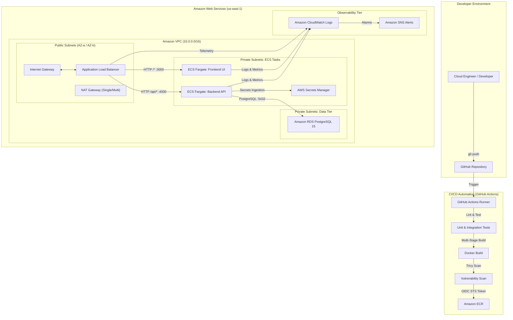
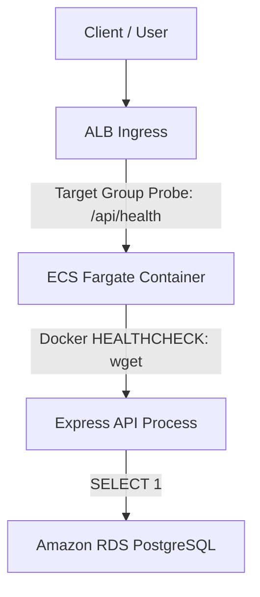

# AetherGrid — Architecture Documentation

**Tagline:** Engineering the Invisible.

---

## 1. Executive Summary

AetherGrid is an enterprise-grade cloud control plane designed to illustrate production DevOps practices: Infrastructure as Code (Terraform), containerization (Docker), zero-trust networking (AWS VPC), serverless container orchestration (ECS Fargate), secure database management (Amazon RDS PostgreSQL), and automated CI/CD (GitHub Actions with OIDC).

---

## 2. High-Level Architecture Diagram

---

## 3. Network Architecture & Subnet Planning

AetherGrid provisions a dedicated VPC with CIDR `10.0.0.0/16` across two Availability Zones (`us-east-1a` and `us-east-1b`):

| Subnet Purpose | Availability Zone | CIDR Block | Route Target | Exposed to Internet |
|---|---|---|---|---|
| Public Subnet 1 | `us-east-1a` | `10.0.1.0/24` | Internet Gateway (`igw`) | Yes (ALB only) |
| Public Subnet 2 | `us-east-1b` | `10.0.2.0/24` | Internet Gateway (`igw`) | Yes (ALB only) |
| Private App 1 | `us-east-1a` | `10.0.11.0/24` | NAT Gateway (`nat`) | No (Outbound only) |
| Private App 2 | `us-east-1b` | `10.0.12.0/24` | NAT Gateway (`nat`) | No (Outbound only) |
| Private DB 1 | `us-east-1a` | `10.0.21.0/24` | Isolated (Local VPC only) | No (Strict Isolation) |
| Private DB 2 | `us-east-1b` | `10.0.22.0/24` | Isolated (Local VPC only) | No (Strict Isolation) |

---

## 4. Multi-Layer Security Architecture

### Ingress & Security Group Isolation
1. **ALB Security Group (`alb-sg`):** Inbound ports 80/443 open to the public internet (`0.0.0.0/0`).
2. **ECS Security Group (`ecs-tasks-sg`):** Inbound ports 4000 (backend) and 3000 (frontend) allow traffic **strictly** from `alb-sg`. Direct internet requests to container IPs are dropped at the ENI level.
3. **RDS Security Group (`rds-sg`):** Inbound port 5432 allows connections **strictly** from `ecs-tasks-sg`. No public IP is assigned to RDS.

### Health Check Chain

